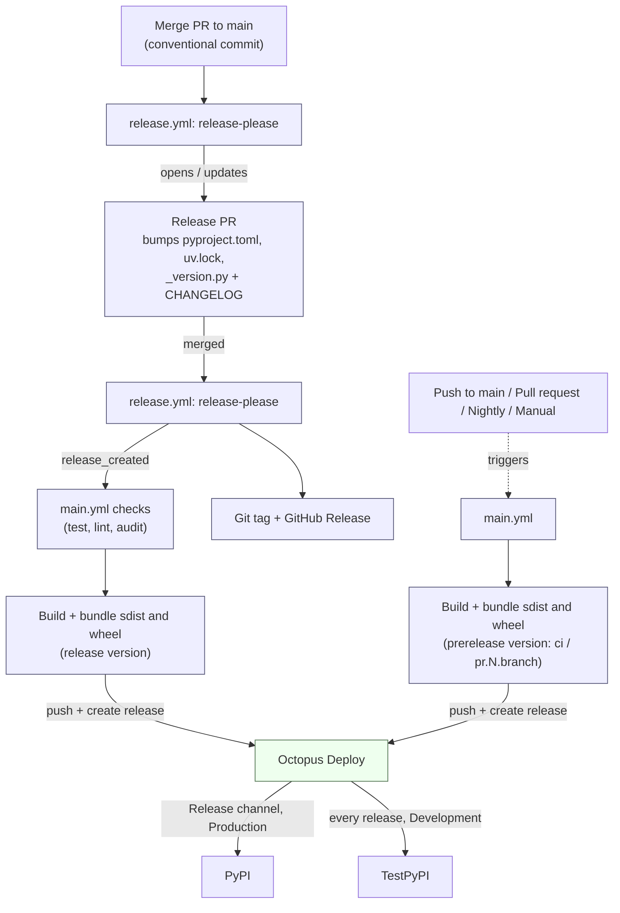

# Releasing

Versioning and publishing are automated. Release Please owns the version and changelog, GitHub Actions builds the sdist and wheel, pushes them to Octopus Deploy and creates a release there, and Octopus Deploy publishes release versions to PyPI.

## Pipeline

- **Release builds** run after a Release Please PR is merged. `release.yml` runs the `main.yml` checks on the release commit, since the build action doesn't test, then builds the release version, pushes the bundle to Octopus Deploy and creates a release.
- **Prerelease builds** run on pushes to `main`, the nightly schedule and manual runs on `main` (all tagged `ci`), and on PRs (`pr.<number>.<branch>`). Fork, Dependabot and Renovate builds aren't pushed. Fork builds upload the sdist and wheel as a workflow artifact instead.
- Every pushed build creates a release in the **OpenFeature Python Provider** project, numbered with the bundle version. The build doesn't choose the channel, so Octopus picks it from the version: prereleases go to Pre-release (Development only) and release versions to Release (Development, then Production).
- The release workflow can also be run manually from the Actions tab to re-run Release Please without pushing a commit, for example after a failed run. Manual runs only do anything on `main`.

## Versioning

- The first release is `0.1.0`, set by `initial-version` in `release-please-config.json`. It has no effect once a release exists.
- While the major version is 0, a breaking change bumps the minor version (`bump-minor-pre-major`), so it can't promote the provider to `1.0.0` by accident.
- The release PR updates the version in three places, listed in `extra-files`:
  - `src/octopus_openfeature_provider/_version.py`, through its `x-release-please-version` marker.
  - `pyproject.toml`, at `$.project.version`.
  - `uv.lock`, which records the project's own version too. Without it, `uv lock --check` fails on the release PR. Release Please's TOML parser wraps each value in an object, so the JSONPath filter compares `@.name.value`, not `@.name`.
- `tests/test_package.py` checks `_version.py` matches the package metadata, so a version file Release Please misses fails the release PR.
- **A published version is permanent.** PyPI never accepts a version again once it's been uploaded, even if it's deleted. Check the version in the release PR before merging.

## Cutting a release

1. Merge changes to `main` using a [conventional commit message](https://www.conventionalcommits.org/).
2. Release Please opens or updates a **release PR** that bumps the version and updates the changelog.
3. Merge the release PR. The tag, GitHub release, checks, build, push to Octopus Deploy and Octopus release run automatically.
4. Promote the release to Production in Octopus Deploy to publish it to PyPI.
5. Confirm the version on [PyPI](https://pypi.org/project/octopus-openfeature-provider/#history).
